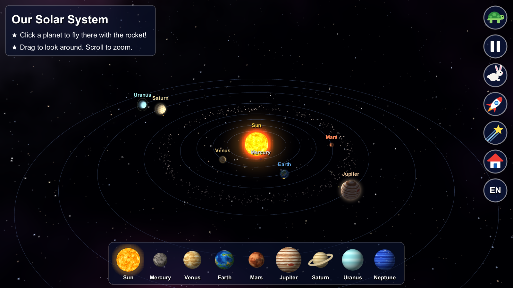
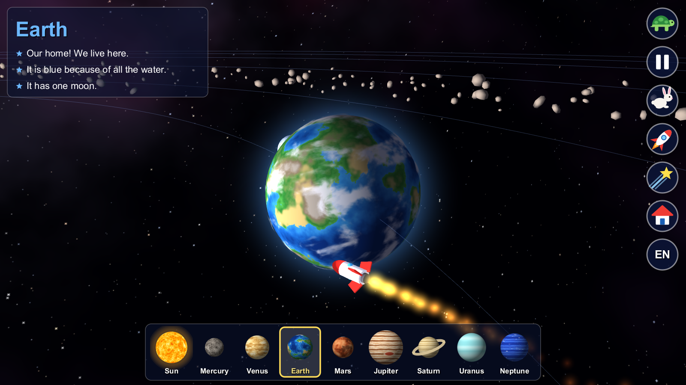
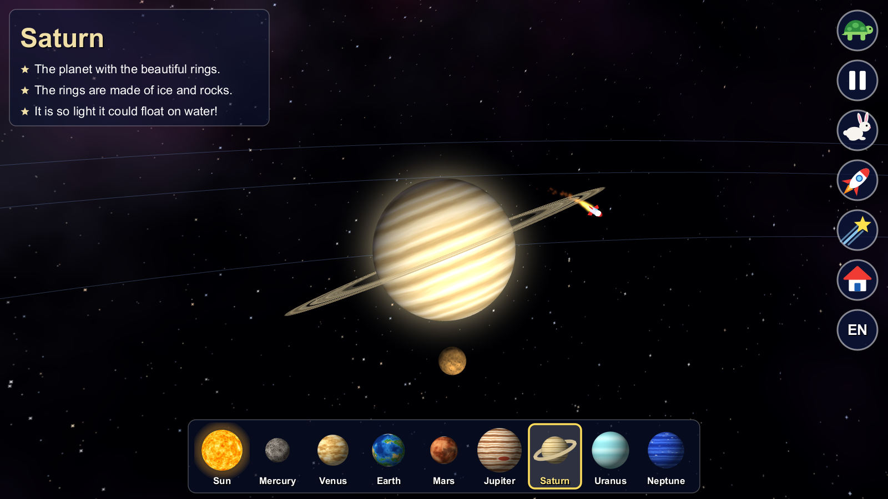

# Planets for Kids 🚀

**A 3D solar system that small children can fly through by themselves.**
Click a planet, and a little rocket takes you there. No reading needed, no menus, no ads, no internet.

Made by a dad for his own two small children, for ages 4 and up.

## What children can do

- **Click any planet** (in space or in the picture bar at the bottom) and ride along as the rocket flies there.
- **Turtle and rabbit** buttons make everything slower or faster.
- **Rocket button** starts a tour that visits the Sun and every planet, one after the other.
- **Star button** sends a comet swinging around the Sun.
- **House button** goes back to the whole solar system.
- Drag with the mouse to look around, scroll to zoom.

Each stop shows the name and three short facts a grown-up can read out loud, such as
"Saturn is so light it could float on water!"
The **EN / DE** button switches all text between English and German.

| | |
|---|---|
|  |  |

## Download and play (Windows)

1. Download **Planets-windows.zip** from the [latest release](../../releases/latest).
2. Unzip it anywhere.
3. Double-click **Planets.exe** in the `Planets` folder.

Nothing to install: the zip brings its own Java. It needs 64-bit Windows and a graphics card
or chip from roughly the last ten years.

The program is not code-signed, so Windows may show a blue "Windows protected your PC" box
the first time. Click *More info*, then *Run anyway*.

Press `Esc` to quit.

## Keyboard (for grown-ups)

| Key | What it does |
|-----|--------------|
| `1` to `8` | Fly to Mercury … Neptune |
| `0` | Fly to the Sun |
| `←` `→` | Previous / next stop |
| `↑` `↓` | Faster / slower |
| `Space` | Pause |
| `T` | Rocket tour on / off |
| `C` | Launch a comet |
| `H` | Back to the whole solar system |
| `L` | English / German |
| `Esc` | Quit |

## Good to know

- Sizes, distances and speeds are **not to scale**. In a true-scale model the planets would be
  invisible dots and Neptune would need more than an hour for one lap.
- All eight planets, the Moon, Jupiter's four big moons, Titan, Saturn's rings and the asteroid
  belt are there. The planet surfaces are painted by the program itself, they are not photos.
- There is no sound.

## Run from source

You need Java 21 or newer. Everything else is downloaded by the build.

| System | Command |
|--------|---------|
| Windows | `run.bat` |
| Linux, or WSL on Windows | `./run.sh` |

To build the Windows zip yourself, run `package-windows.ps1` in PowerShell.

The code is four Java files in `src/main/java/planets`, built with
[jMonkeyEngine](https://jmonkeyengine.org/) 3.9.

## Support

If your kids had fun with this, you can [buy me a coffee on Ko-fi](https://ko-fi.com/arthur9366) ☕

## License

[MIT](LICENSE). jMonkeyEngine and LWJGL, which the download includes, are under their own
BSD-style licenses.
